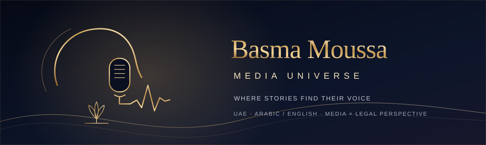
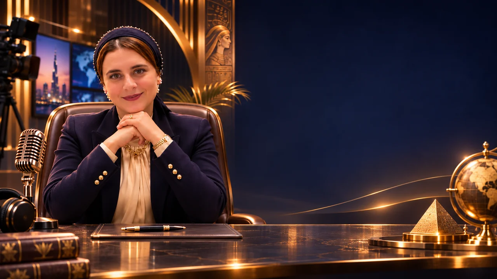
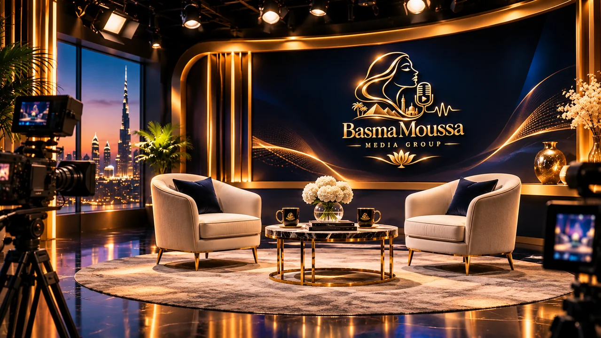
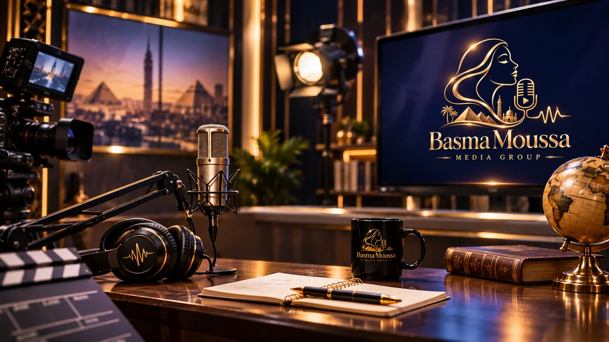

<p align="center"></p>

# BASMA MOUSSA ✦ MEDIA UNIVERSE
### Stories. Vision. Connection. · لكل حكاية صوت... ولكل صوت رؤية

<p align="center">
  <strong>Basma Moussa · Media & Legal Perspective · United Arab Emirates</strong><br/>
  <em>A cinematic, bilingual, editorial-first digital media experience.</em>
</p>

> **Project status — WORKING BILINGUAL APPLICATION / PRE-LAUNCH.** The Next.js 16 application is implemented and verified locally: production build, 43 unit/component tests, and 28 Playwright tests covering the splash, portal doors, real 404s, accessibility (WCAG A/AA), SEO, responsive layouts, image loading, and a measured performance budget. A GitHub Actions quality workflow is committed and runs with the pull request. There is **no public deployment, no published episode, no audio player, no CMS/database, and no claim of a live broadcast**. All cinematic scenes and portraits are owner-supplied illustrative or brand imagery.

**Read the product** · [Cinematic doors & golden-thread splash](docs/MEDIA_WORLD_INTERACTIONS.md) · [Creative direction](docs/CREATIVE_DIRECTION.md) · [Editorial guardrails](docs/EDITORIAL_GUARDRAILS.md) · [Real content sources](docs/REAL_CONTENT_SOURCES.md) · [Current status](docs/STATUS.md).

<p align="center"></p>
<p align="center"><em>Approved visual direction — concept artwork, not a claim of launched programming.</em></p>

<p align="center"> </p>

---

## ✦ What exists now | ما هو موجود الآن

A complete, bilingual editorial experience that can be run and reviewed today:

- **Cinematic home** with a chapter rail, viewfinder framing, a portrait-safe copy column, and an honest project-status strip.
- **Golden-thread splash**: SVG threads draw into the approved logo, with a keyboard-accessible skip, session memory, replay (`?replay=1`) and a pre-hydration fallback (`?no-intro=1`).
- **Portal doors**: every world block is a real anchor. Activating one expands a two-panel door from the card, parts it around a gold seam, and arrives at the destination world.
- **Media Universe gateway** with client-side search, category filters, deferred input, live result count, empty state and reset.
- **Four program worlds**: Beyond the Frame, The Legal Lens, City Voices, Soundroom — all explicitly “Concept · in development”, with zero episodes.
- **Soundroom** with a clearly decorative waveform, a motion pause control, and no fake audio element or hidden player.
- **Legal Lens** with four official website entry points, visible review dates, jurisdiction notes, editorial outlines, and a standing “not legal advice” notice.
- **Stories, Studio, About, Contact and Privacy** pages with an honest publication policy, a project-level accuracy note, and one verified WhatsApp channel.
- **Real 404s**: unknown paths return an HTTP 404 with localized, designed content and `noindex`; legacy `/programs` redirects to `/media`.
- **SEO**: canonical URLs, `hreflang` for both locales, Open Graph/Twitter cards, localized JSON-LD, sitemap and robots.
- **Accessibility**: skip link, focus-managed mobile menu, keyboard-operable portal links, reduced-motion behavior, WCAG A/AA axe scans with zero reported violations, RTL/LTR parity.

## ✦ The vision | الرؤية

**Basma Moussa Media Universe** is the proposed digital home for Basma Moussa (بسمة موسى): an emerging media identity grounded in human storytelling, thoughtful dialogue, and an established background in legal research.

This is **not** a generic influencer landing page, a law-firm site, a fictional television channel, or a claim that a registered media group already operates. It is a scalable, editorially credible platform concept intended to grow into a genuine multimedia destination.

**الرؤية:** بناء منصة إعلامية رقمية راقية تعرض رؤية بسمة موسى، تجمع الحكاية الإنسانية مع الخبرة البحثية القانونية، وتخاطب جمهور الإمارات والخليج والعالم العربي في تجربة عربية/إنجليزية سينمائية وسهلة الاستخدام.

### Product pillars

| Pillar | Experience | Publication rule |
|---|---|---|
| **Media Universe** | A map of four conceptual worlds with real routes and cinematic doors | Every world is labelled *Concept · in development* |
| **Beyond the Frame** | Conversation concept and long-form formats | No invented guests or episodes |
| **The Legal Lens** | Source-first legal awareness and editorial outlines | Official links only; never individual advice |
| **City Voices** | Documentary concept rooted in UAE places | No staged scene presented as field reporting |
| **Soundroom** | Audio-production concept with a decorative waveform | No audio until a real, rights-cleared file exists |
| **Stories & Studio** | Archive and production-method pages | Publish only verified stories; label illustrations |
| **About & Contact** | Approved identity, accuracy note, WhatsApp channel | No unverified biography claims or fake forms |

## ✧ Design direction

- **Palette:** midnight navy / near-black, brushed metallic gold, champagne and ivory.
- **Signature symbol:** the approved gold feminine profile → microphone → soundwave, with a restrained lotus/heritage micro-detail.
- **Cinematic system:** a film-grain layer, viewfinder corners, chapter numbering, oversized editorial typography, gold hairlines, and image-led worlds.
- **Doors, not cards:** portal blocks part like a two-panel door, with a gold seam and an arrival state.
- **Bilingual by design:** Arabic RTL and English LTR compositions are authored separately, not mechanically mirrored. The hero copy is physically anchored clear of the portrait’s face in both directions.
- **Motion with consent:** CSS motion only; `prefers-reduced-motion` disables the splash, door animation and decorative motion without hiding content.

Detailed rules: [Creative direction](docs/CREATIVE_DIRECTION.md) · [Vision evolution from original HTML](docs/ORIGINAL_VISION_PARITY.md) · [Asset manifest](docs/ASSET_MANIFEST.md).

## 🗺️ Experience architecture

```text
/ar · /en                         Home / الرئيسية
├── /about                        About Basma / عن بسمة
├── /media                        Media Universe / عالم الإعلام
│   ├── /programs/beyond-the-frame   Beyond the Frame / خارج الإطار
│   ├── /programs/city-voices        City Voices / صوت المدينة
│   └── /soundroom                   Soundroom / مساحة صوت
├── /legal-lens                   The Legal Lens / من زاوية القانون
├── /stories                      Stories & Archive / القصص والأرشيف
├── /studio                       Studio & Method / الاستوديو
├── /contact                      Collaborate / لنتعاون
└── /privacy                      Privacy / الخصوصية
```

The locale-less root redirects to `/ar`; `/ar/programs` redirects to `/ar/media`; unknown paths return a real 404. The `[locale]` routes are statically generated for both languages.

## 🧱 Technical stack (implemented)

| Layer | Implementation |
|---|---|
| Application | Next.js 16 App Router, React 19, TypeScript strict mode |
| Styling | Tailwind CSS v4 + a hand-authored design system in `app/globals.css` |
| Internationalization | Custom typed dictionary, locale-aware paths, RTL/LTR, `hreflang` |
| Content | Typed JSON validated with Zod; one asset registry; no database |
| Motion | CSS keyframes, native view-timeline reveals, door overlay animations |
| Media | Owner-approved images with blur placeholders; no audio/video playback yet |
| SEO | Metadata builder, localized JSON-LD, sitemap, robots, real 404 status |
| Quality | ESLint, `tsc --noEmit`, Vitest + Testing Library, Playwright + axe-core |
| CI | GitHub Actions `App Quality` workflow (lint, types, unit, build, browser tests) |
| Deployment | None performed; no production URL exists |

## 🚀 Run locally

```bash
npm ci
npm run dev            # http://localhost:3000
npm run build && npm start
```

```bash
npm run lint           # ESLint
npm run typecheck      # TypeScript
npm run test           # 43 unit/component tests
npm run test:e2e       # 28 browser tests; requires a production build
```

The Playwright suite starts `next start` on port `3100` and expects a completed `npm run build`. It covers splash behavior, locale switching, mobile navigation, portal doors and back navigation, media filtering, soundroom honesty, legal sources, contact honesty, true 404s, canonical/hreflang metadata, sitemap/robots, axe accessibility for Arabic and English routes, 390px overflow, image loading, and LCP/CLS budgets.

## 📐 Visual assets

Fourteen owner-supplied images are stored in `public/media` and `public/brand`, with alt text, focal points, blur placeholders, provenance and an explicit editorial status in `content/media-assets.json`. Every illustrative asset remains review-required and has `publishedClaimAllowed: false`. Real photography and AI concept imagery stay distinguishable in captions and metadata.

See [Asset manifest](docs/ASSET_MANIFEST.md) for paths, focal points, formats and approval gates.

## 🔐 Trust, accuracy & privacy

- Do not publish passports, visas, certificates, sensitive identity data, confidential legal files or the supplied raw CV PDFs into this public repository.
- Don't infer UAE legal-practice authorization from a biography or an image.
- Never invent media partnerships, awards, broadcast episodes, viewers, client testimonials or published events.
- Explicitly label generated media studio/interview scenes as illustrative concepts where necessary.
- All contact actions must work; forms require a real configured delivery endpoint.
- Legal-awareness material is educational, not individualized legal advice.
- Only publish personal contact information following subject approval.

See [Editorial & safety policy](docs/EDITORIAL_GUARDRAILS.md).

## 🧭 Delivery roadmap

- [x] Verify repository and protect existing work
- [x] Record brand, visual direction and editorial guardrails
- [x] Curate and publish 14 owner-supplied illustrative/brand assets with metadata
- [x] Build the working bilingual Next.js application
- [x] Implement the splash, portal doors, all internal routes, search/filter, 404s and SEO
- [x] Add unit/component tests, browser tests, accessibility scans and a performance budget
- [x] Add the `App Quality` CI workflow
- [ ] Confirm the first remote CI run and merge the verified pull request
- [ ] Replace illustrative imagery with approved photography where desired
- [ ] Connect a real CMS/database and audio delivery when content exists
- [ ] Verify biography, legal credentials and media rights with Basma
- [ ] Deploy to an approved domain and run live smoke tests
- [ ] Publish the first real episode only after consent, review and rights clearance

**Do not claim a deployment, published episode, audio player or verified API without evidence.** The checked boxes above reflect code and local verification, not a live public launch.

### Contributing

Use focused branches and pull requests. Keep `main` as the integrated reference; do not force-push or delete unmerged work. Do not claim *RELEASED* without deployment proof.

---

<p align="center"><strong>BASMA MOUSSA</strong><br/>Where Stories Find Their Voice<br/>© 2026 · Brand and editorial concept · Rights and licensing to be confirmed before public release.</p>
